# Lotus58 ZMK keymap

ZMK config for a wireless Lotus58 split keyboard (nice!nano v2, nice!view with the gem screen).

- Keymap: [config/lotus58.keymap](config/lotus58.keymap)
- How to build, release and flash: [FLASHING.md](FLASHING.md)
- Every flashed version is a [GitHub Release](../../releases) with its firmware and keymap picture

## Current keymap

Redrawn automatically by keymap-drawer on every keymap change.

